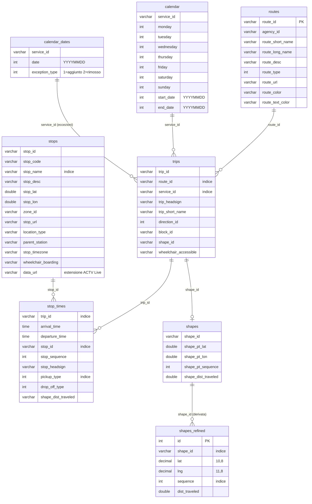
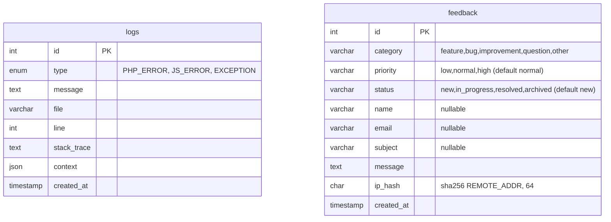

# 03 — Database

MySQL 8 / MariaDB, charset `utf8mb4`. Accesso esclusivamente tramite
`databaseConnector` (PDO, prepared statements nativi, `PDO::FETCH_ASSOC`).

## Diagramma ER



## Tabelle applicative



Indici su `feedback`: `idx_feedback_status(status)`,
`idx_feedback_category(category)`, `idx_feedback_created(created_at)`.
La tabella è creata lazy (`CREATE TABLE IF NOT EXISTS`) sia dall'API pubblica
sia dal pannello admin.

### Tabelle legacy

`tm_sessions` e `tm_data` (Time Machine) sono create da `scripts/setup_db.php`
per compatibilità ma **non usate** da nessuna rotta corrente.

```sql
CREATE TABLE tm_sessions (
  id INT AUTO_INCREMENT PRIMARY KEY,
  name VARCHAR(255) NOT NULL,
  start_time DATETIME NOT NULL,
  end_time DATETIME NOT NULL,
  status ENUM('SCHEDULED','RECORDING','COMPLETED') DEFAULT 'SCHEDULED',
  stops JSON NOT NULL,
  created_at TIMESTAMP DEFAULT CURRENT_TIMESTAMP
);
```

## Note sullo schema GTFS

- **`stops.data_url`** — campo custom (non GTFS). Contiene il segmento usato dal
  backend realtime ACTV, es. `4-1004-web-aut`. Più `stop_id` GTFS possono
  condividere lo stesso `data_url`. Compilato dalla pipeline associando gli ID
  trovati nella `description` del feed realtime.
- **`stop_times` e orari oltre le 24:00** — il feed usa orari `>= 24:00:00` per
  le corse notturne; la colonna è `time` ma i planner lavorano in secondi interi.
- **`pickup_type`/`drop_off_type`** — `0`/`NULL` regolare, `1` non disponibile,
  `2` su prenotazione telefonica, `3` coordinamento con personale.
- **`shapes_refined`** — copia applicativa di `shapes` con PK auto-incrementale,
  `lat`/`lng` decimal e `dist_traveled`; letta da `/api/bus-position` e
  `/api/lines-shapes` per le geometrie delle mappe.
- **Dimensioni tipiche** (feed di riferimento): `routes` ~97, `trips` ~30k,
  `stops` ~2.2k, `stop_times` ~690k, `shapes` ~700k righe.
- **Aggiornamento atomico** — l'import avviene su tabelle di staging e viene
  pubblicato con `RENAME TABLE`, così un update fallito non corrompe i dati
  pubblicati (vedi [05-pipeline-gtfs.md](05-pipeline-gtfs.md)).
- **Tabella `logs`** — `context` JSON contiene User-Agent, URL e payload client
  per i `JS_ERROR`.

## Query tipiche usate dall'app

```sql
-- Fermate ordinate di una corsa (trip-details, bus-position)
SELECT stops.*, stop_times.*
FROM stops INNER JOIN stop_times ON stops.stop_id = stop_times.stop_id
WHERE stop_times.trip_id = ?
ORDER BY stop_times.stop_sequence;

-- Corse attive ora (gtfs-bnr): oggi + ieri (orari >24:00)
SELECT ... FROM stops JOIN stop_times ... JOIN trips JOIN routes JOIN calendar
WHERE calendar.<giorno> = 1  UNION ALL  (... ieri, arrival_time >= '24:00:00');
```
