# 08 — Pagine e funzionalità (con screenshot)

Screenshot reali a 390×844 in `docs/spec/screenshots/`. Ogni pagina elenca:
route → azione → view → JS → API/storage usati.

## 8.1 Home `/`

 

`Controller::index()` → `home.php` + `script-home.js`, `StopCard.js`, `tour.js`,
`widget.js`, Leaflet, qrcode-generator.

Struttura top→down:

1. **Header onda verde** con brand "ACTV Live", titolo "Il tuo viaggio, in tempo
   reale.", sottotitolo "Orari, fermate e percorsi ACTV a Venezia", toggle tema.
2. **Card benvenuto/tour** (`#home-tutorial`, visibile solo al primo avvio):
   "Vuoi fare un giro?" con bottoni "Inizia il tour" / "Salta"
   (`home_tutorial_seen`).
3. **Card "Servizio ACTV"** con CTA "Cerca una fermata" → `/stopList`.
4. **"Il tuo ultimo viaggio"** (`#journey-resume`, visibile se `route_origin`+
   `route_destination` in localStorage): "Riprendi viaggio" → `/route-results`,
   "Modifica" → `/route-finder`; riprendere aggiorna data/ora a *adesso*.
5. **"Le tue fermate"** — card `StopCard` dai `favorite_stops` (sezione nascosta
   se vuota).
6. **"Fermate vicine"** — geolocalizzazione browser (`map.locate`); le 5 fermate
   più vicine via Haversine client-side; banner `#status` "In attesa di
   geolocalizzazione..." / errore / posizione trovata.
7. **Mappa Leaflet** (300px, fullscreen plugin) con marker circolari delle
   fermate (raggio scala con lo zoom), popup con nome + linee + distanza.
8. **Griglia azioni** (2 colonne, 1 su ≤430px): Cerca una fermata, Percorsi,
   Statistiche ritardi, Orari delle linee, Cerca una corsa, ✎ Invia feedback
   (verde).
9. **Avvisi sciopero**: campionamento di 15 fermate realtime; se i passaggi RT
   sono assenti su campioni multipli → FAB rosso "!" + modal `strike-card` con
   elenco fermate e testo avviso.
10. **Footer** MIT + autori + link GitHub/crediti + disclaimer "non affiliato ad
    ACTV S.p.A."; **7 click** sul footer aprono `/route` (protetta admin).
11. **QR FAB** verde in basso a destra → modale con QR dell'URL corrente.
12. **Bottom nav** fissa (Home/Fermate/Percorsi/Altro).

Dati: nessuna fetch server-side; tutto client (`/api/stops` per fallback,
`oraritemporeale.actv.it/.../stops` per la mappa).

### Home alternativa `/home-alt`

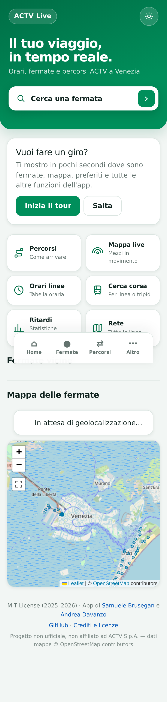

Stessa logica, layout "product hero": hero verde con barra di ricerca finta,
griglia 6 action card (Percorsi, Mappa live, Orari linee, Cerca corsa, Ritardi,
Rete), sezioni preferiti/vicini/mappa in stile `ha-*`, footer compatto.

## 8.2 Cookie consent

`CookieNotice` bottom-sheet animato (slide-in): titolo "Cookie & Privacy",
testo con link `/privacy`, bottone "Accetta". Solo se
`cookie_consent_accepted` assente; GA caricato solo dopo consenso.

## 8.3 Elenco fermate `/stopList`

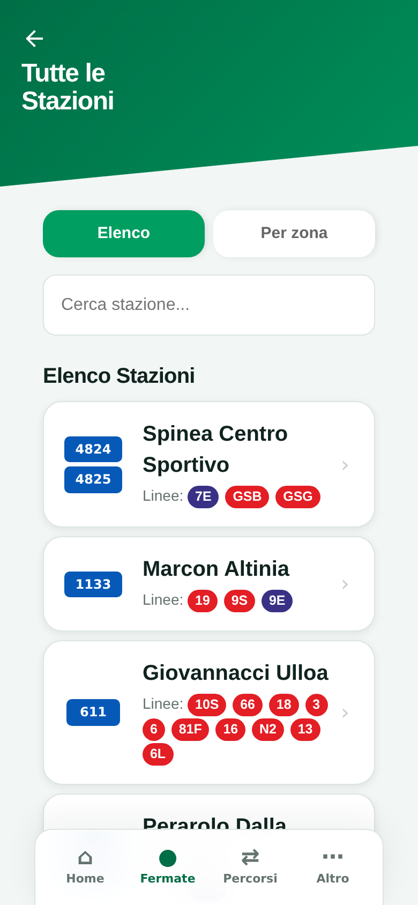 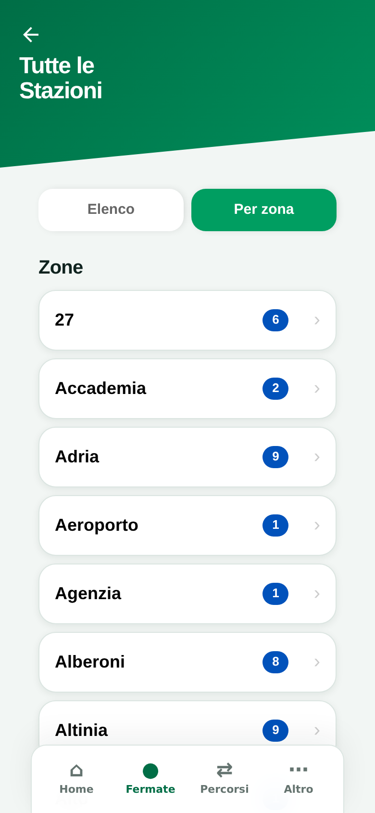

`Controller::stops()` scarica il catalogo ACTV realtime (cURL, timeout 0.5s);
la view unisce le stazioni per nome pulito (`Nome [id1] [id2]` → rimuove `[n]`,
merge ID e linee, max 4 alias mostrati + "…").

- **Tab** "Elenco" / "Per zona" (zone = prima parola del nome, conteggio,
  drill-down con back).
- **Ricerca fuzzy** in tempo reale: normalizza accenti, `santa|san → s`,
  match esatto/prefisso/Levenshtein, **riordina i risultati per score**;
  match anche sugli ID (`data-all-ids`).
- Ogni card: badge ID impilati, nome, "Linee: …" (sostituite da badge colorati
  via `/api/line-colors`), chevron → `/aut/stops/stop?id=<id1-id2>&name=<n>`.
- Le fermate di **navigazione** sono aggiunte via `/api/navigation/stops`
  (gruppo "Fermate Navigazione", badge "⛴ Navigazione").
- Fallback offline: se la lista è vuota, `getStopsFromGTFS()` →
  `/api/gtfs-stops` e card con nota "Servizio non in tempo reale".

## 8.4 Dettaglio fermata `/aut/stops/stop?id=<ids>&name=<nome>`

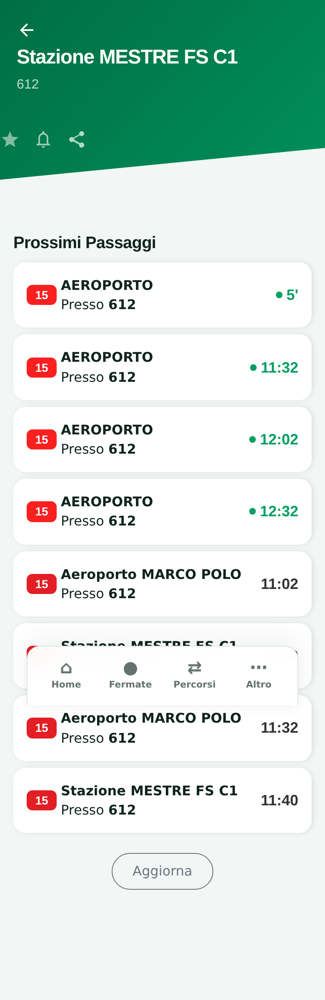

`stop.php` + `stop.js`. Header: back, nome, ID; azioni **preferito** (stella),
**notifiche** (campana → pannello soglia 3/5/10/15 min), **share** (widget).

- `#filter-container`: filtri per linea/destinazione (sessionStorage).
- `#noticeboard`: bacheca avvisi ACTV collassabile con icone per tipo nota.
- "Prossimi Passaggi": merge `oraritemporeale.actv.it/.../passages/<id>-web-aut`
  + fallback GTFS (`/api/gtfs-passages`, `/api/navigation/passages`), dedup
  realtime/schedulato (tolleranza 10 min), rilevamento sciopero, veicoli
  realtime associati ai passaggi con distanza/progresso.
- Card passaggio: badge linea colorato, destinazione + "Presso <id>",
  orario/`MM'` con dot verde se realtime, grigio se schedulato; click →
  `/trip-details` con contesto in sessionStorage.
- Ogni osservazione di ritardo alimenta `delay_history`.
- Bottone "Aggiorna" (reload).

## 8.5 Route finder `/route-finder`

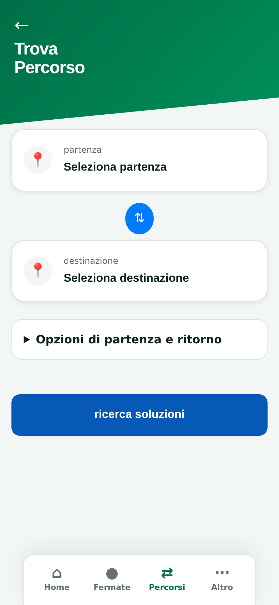

Card selezione partenza/destinazione (icona 📍), bottone swap ⇅,
`
` "Opzioni di partenza e ritorno" con:

- trigger data (calendario modale custom con navigazione mese);
- trigger ora (time-picker a due ruote iOS con highlight centrale);
- pill ottimizzazione: **tempo** (default) / **cambi** / **a piedi**;
- toggle **ritorno** + time picker ritorno;
- bottone "ricerca soluzioni" → salva `route_*` → `/route-results`.

La selezione fermata apre `/station-selector?embedded=1` dentro il pannello
iframe `station-picker-panel` (bottom sheet ~88vh). Tragitti preferiti
(`favorite_routes`) mostrati sopra se presenti.

## 8.6 Station selector `/station-selector`

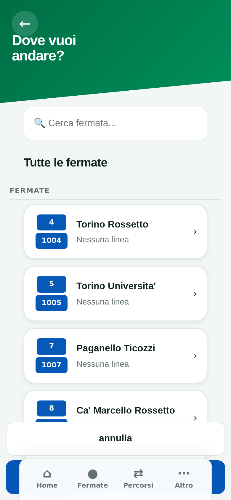

Header "Dove vuoi andare?"/"Seleziona destinazione" (`?type=`), search input
con ricerca fuzzy + **geocoding Nominatim** (5 risultati, viewbox Venezia),
sezioni Recenti / Preferite / Tutte le fermate. Click seleziona (card
evidenziata `#E8F5E9` + bordo verde), bottoni "annulla"/"fatto"; scrive
`route_origin|route_destination` e torna a `/route-finder`. Con `?embedded=1`
gira nel pannello iframe (classe `embedded-picker`).

## 8.7 Risultati `/route-results`

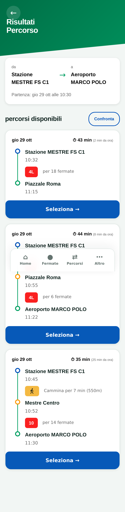

Riepilogo da→a con data/ora; spinner "Ricerca percorsi in corso…"; poi card
percorso con timeline (origine • badge linea • destinazione), durata e
"(N min da ora)", bottone "Seleziona →". Funzioni:

- **tab Andata/Ritorno** se `route_return_trip` (seconda chiamata plan-route);
- **Confronta**: modalità selezione multipla + barra "Confronta percorsi" →
  modal con mappa Leaflet affiancata (espandibile) e tabella comparativa;
- modal "Dettagli Viaggio" per percorso;
- stato vuoto: 🚫 "Nessun percorso trovato per i parametri specificati" + back;
- enrich realtime: posizione veicolo per `trip_id` sulle leg transit.

## 8.8 Dettagli viaggio `/route-details`

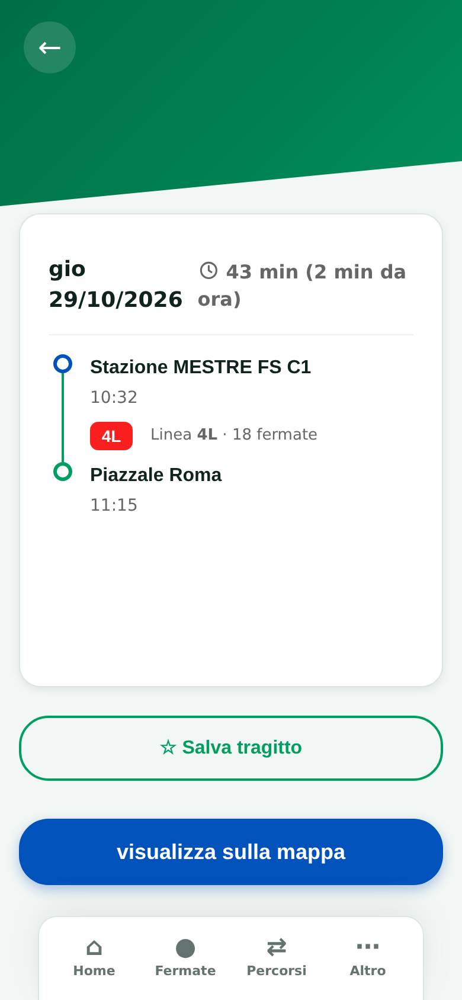 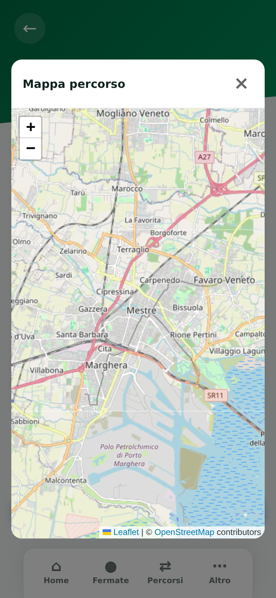

Legge `selected_route`. Card con data + durata totale, timeline completa delle
legs (fermata → badge linea "per N fermate" → arrivo; "Cammina per N min
(m m)"), info "parti da qui" se l'utente è vicino all'origine, bottone
"☆ Salva tragitto" (`favorite_routes`), "visualizza sulla mappa" → modal con
polyline dei legs e marker fermate.

## 8.9 Mappa linee `/lines-map`

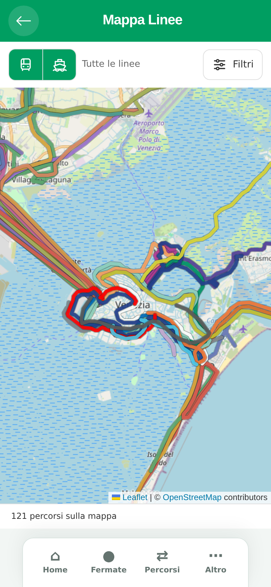

Fullscreen Leaflet: tutte le shape (status "N percorsi sulla mappa"), service
switch bus/vaporetto, pannello "Filtra percorsi" (per linea CSV o ID corsa,
toggle "Mostra le fermate", Rimuovi/Applica), colori deterministici per linea,
lane-offset per segmenti sovrapposti (`mapRouteLanes.js`). Fonte:
`/api/lines-shapes`.

## 8.10 Mappa live `/live-map`

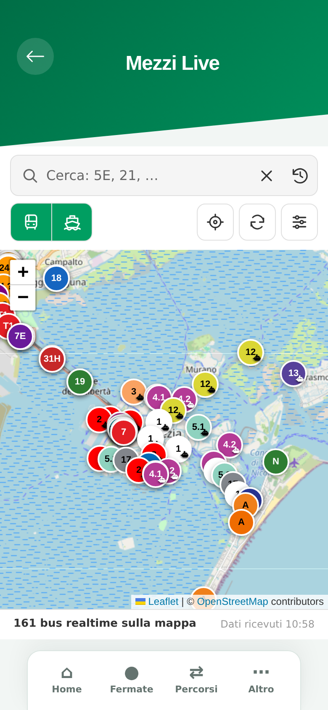 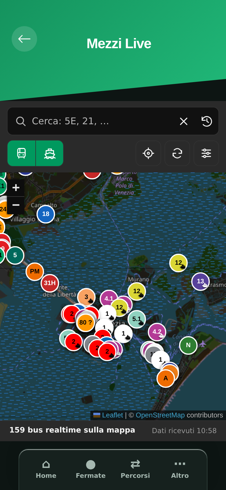

Header "Mezzi Live" + toolbar: search "Cerca: 5E, 21, …" (CSV multipli, clear,
storico ricerche), service switch autobus/vaporetti (entrambi attivi di
default), bottoni posizione/refresh/impostazioni. Impostazioni: campi di
ricerca attivi (Linea/Destinazione/ID corsa), toggle "Mezzi senza linea N/D".

Marker circolari colorati per linea (14 colori deterministici, `.mini` da 16px
in sovrapposizione), stati: realtime (z-index alto), `scheduled` grigio,
`scheduled-api` grigio scuro bordo tratteggiato. Panel dettaglio mezzo a
destra; pannello N/D collassabile. Status bar: "N bus realtime sulla mappa" +
"Dati ricevuti HH:MM". Auto-refresh 60s, max 6 fetch parallele, posizione
interpolata sulla shape raffinata tra fermata passata e prossima
(`findNextStopWithDelay`).

## 8.11 Trip finder `/trip-finder`

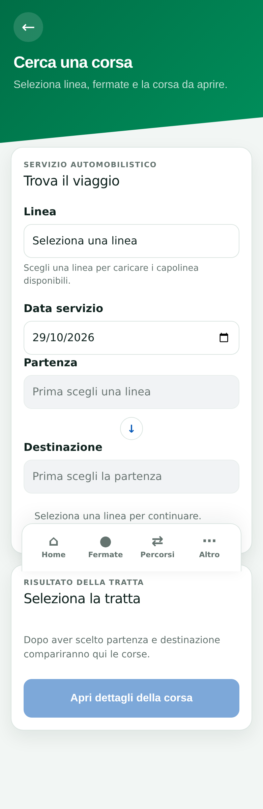

Wizard card: "Servizio automobilistico" + Linea (`/api/line-catalog`),
Data servizio (default oggi), Partenza (prima fermata delle varianti),
Destinazione (ultima, solo se dopo la partenza), status aria-live. Lista corse
(`/api/line-trips`) con conteggio, paginazione 10/pagina, "Vai alla pagina" e
"Vai all'orario". Badge "In movimento secondo orario" se ora ∈
[partenza−30min, arrivo+30min] e data = oggi. "Apri dettagli della corsa" →
`/trip-details`. Stato persistito in `sessionStorage.actvLive.tripFinder`.

## 8.12 Orari delle linee `/line-schedule`

Service switch bus/vaporetto, ricerca linea (numero o destinazione) + select.
Workspace: aside varianti (direzione + percorso) → matrice orari completa
(fermate × corse) con dedup delle sequenze identiche, legenda "Giorni e
validità delle corse" (numeri sotto le partenze), link alla mappa della corsa
rappresentativa, meta feed (`#feed-meta`).

## 8.13 Dettaglio corsa `/trip-details?tripId=…`

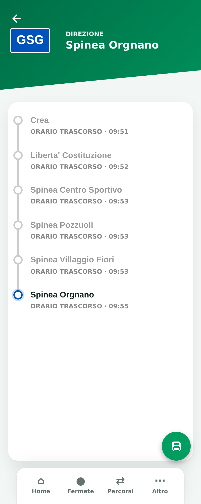

Header: badge linea + "DIREZIONE <headsign>", countdown tempo rimanente +
ritardo (`#time-delay`). Timeline fermate: passate ("ORARIO TRASCORSO" grigio),
prossima evidenziata, future; loader `l-hatch`. FAB mappa → dialog fullscreen:
polyline corsa, marker fermate (legenda passata/da raggiungere), posizione
veicolo realtime + mezzi vicini (raggio `NEARBY_BUS_RADIUS_M`), lista fermate
espandibile con conteggio. Query param: `tripId`, `stopId`, `line`, `dest`,
`time` (+ contesto sessionStorage dalla pagina fermata).

## 8.14 Widget `/widget`

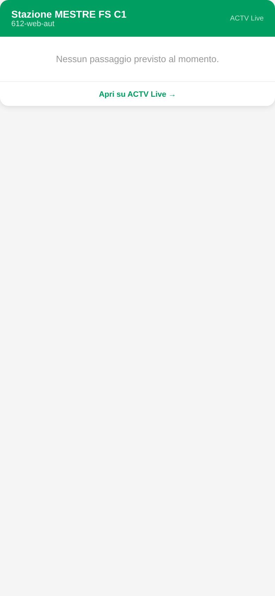

Pagina standalone (no app-shell): header verde `#009E61` (dark: `#004d30`/
`#1a1a1a`), nome+ID fermata, lista passaggi (badge rosso/blu/night, orario
verde se realtime), footer "Apri su ACTV Live →". Parametri: `stop` (obbl.),
`name`, `max` (default 8), `theme=light|dark`. Poll ogni 30s sul backend ACTV.
`widget.js` genera URL+iframe dalla pagina fermata.

## 8.15 Statistiche ritardi `/delay-stats`

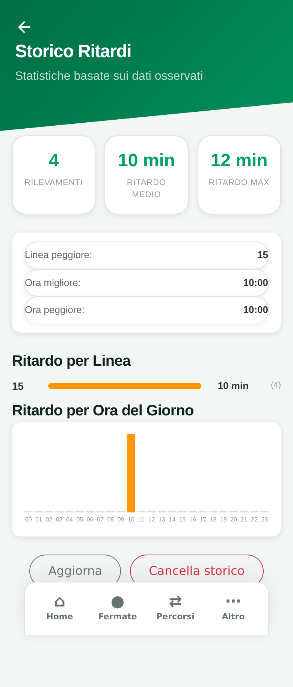

Card riepilogo (Rilevamenti, Ritardo medio, Ritardo max), quick stats (linea
peggiore, ora migliore/peggiore), barre per linea e istogramma orario
(colori soglia verde/arancio/rosso), bottoni Aggiorna / Cancella storico
(`actvConfirm`). Tutto da `delay_history` locale.

## 8.16 Feedback `/feedback`

Form card: categoria (obbl.), priorità, titolo, messaggio 10–5000 (obbl.),
nome/email facoltativi, honeypot invisibile, status inline. → `POST /api/feedback`.

## 8.17 Crediti `/credits`

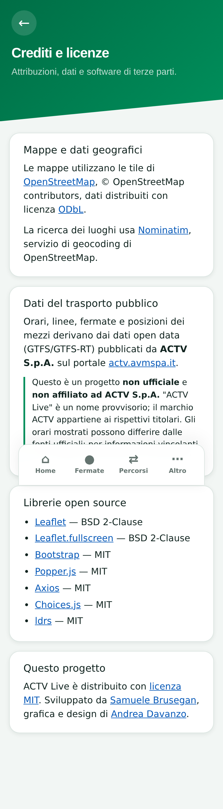

Card: mappe (OSM/ODbL, Nominatim), dati trasporto (ACTV open data + disclaimer
non ufficiale), librerie open source con licenze (Leaflet, Leaflet.fullscreen,
Bootstrap, Popper, Axios, Choices.js, ldrs), progetto MIT + autori.

## 8.18 Privacy `/privacy` (= `/delete-cookie`)

Card: dati locali (elenco chiavi localStorage) + bottoni "Elimina dati locali"
e "Revoca consenso cookie"; cookie (sessione PHP + GA) + "Elimina tutti i
cookie" (`/api/delete-cookie` + lato client); terze parti (OSM/Nominatim, ACTV,
GA); nota feedback.

## 8.19 Area admin

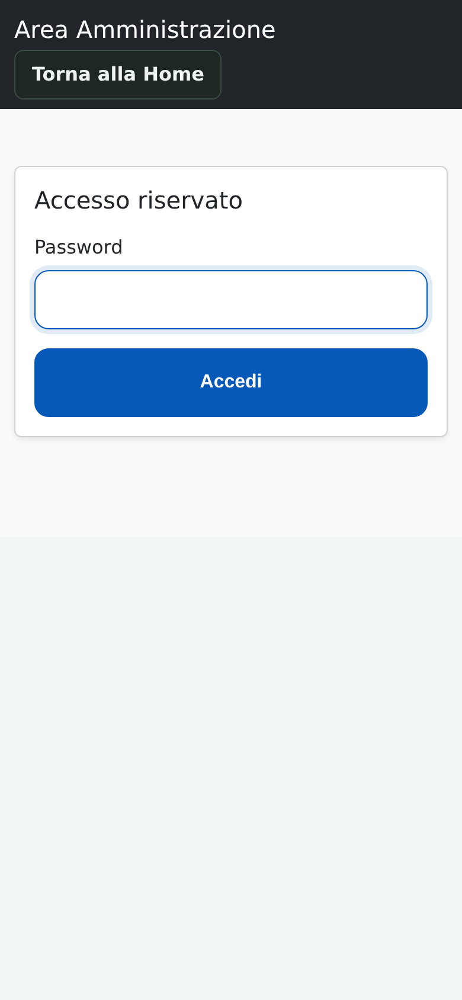

- `/admin/login`: header scuro "Area Amministrazione" + card "Accesso
  riservato" (password + CSRF, errori "Password non valida"/"Sessione scaduta").
- `/admin/dashboard`: metriche flotta live (bus attivi, ritardi, copertura GPS,
  distribuzione per linea) via `adminDashboard.js`.
- `/admin/logs`: tabella ultimi 100 log, filtro `?type=PHP_ERROR|EXCEPTION|
  JS_ERROR`, dettaglio context/stack.
- `/admin/database-health`: connessione, tabelle richieste, conteggi e
  dimensioni da information_schema, tabelle temporanee GTFS.
- `/admin/gtfs-update`: stato job (idle/running/failed), task, statistiche,
  cache date, log tail; form pianificazione (switch enabled, giorno, ora UTC);
  avvio manuale.
- `/admin/gtfs-rt-inspector`: servizio + tipo feed → payload base64, hex
  preview, record decodificati.
- `/admin/feedback`: tabella feedback, filtri categoria/stato.
- `/route` (protetta): elenco rotte registrate.

## 8.20 GTFS identify `/api/gtfs-identify` (senza `return`)

Pagina diagnostica `gtfsIdentify.php` per testare la risoluzione
passaggio→trip_id (form con i parametri della query GTFS).
