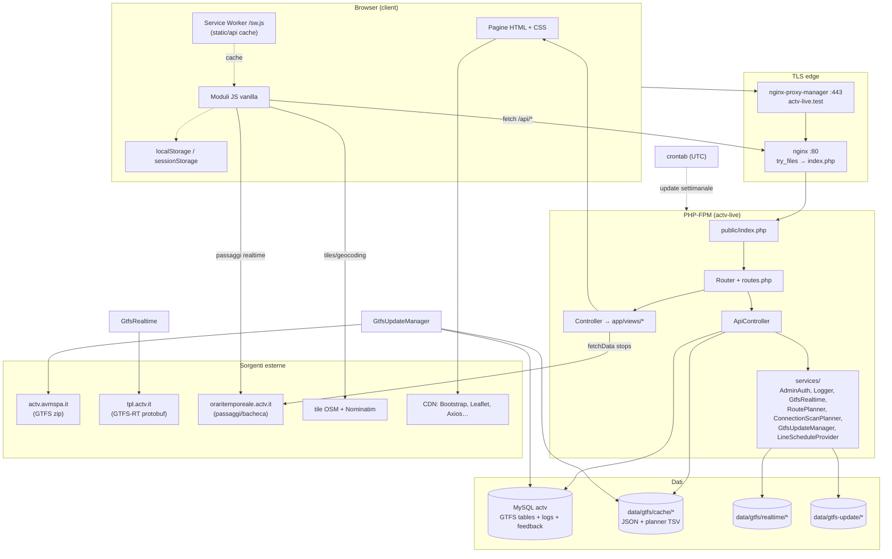
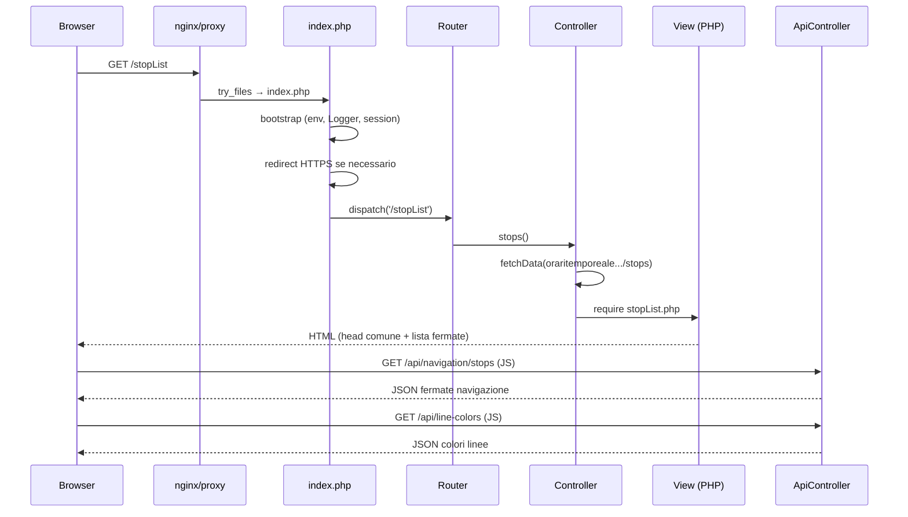
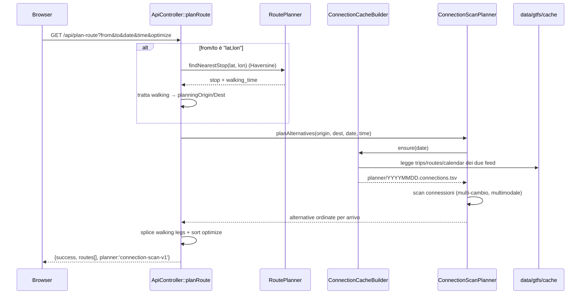
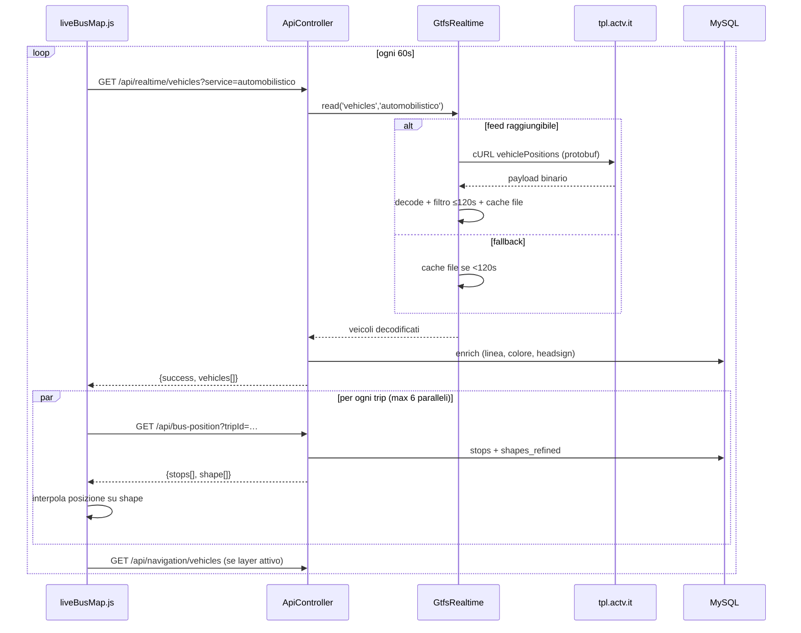
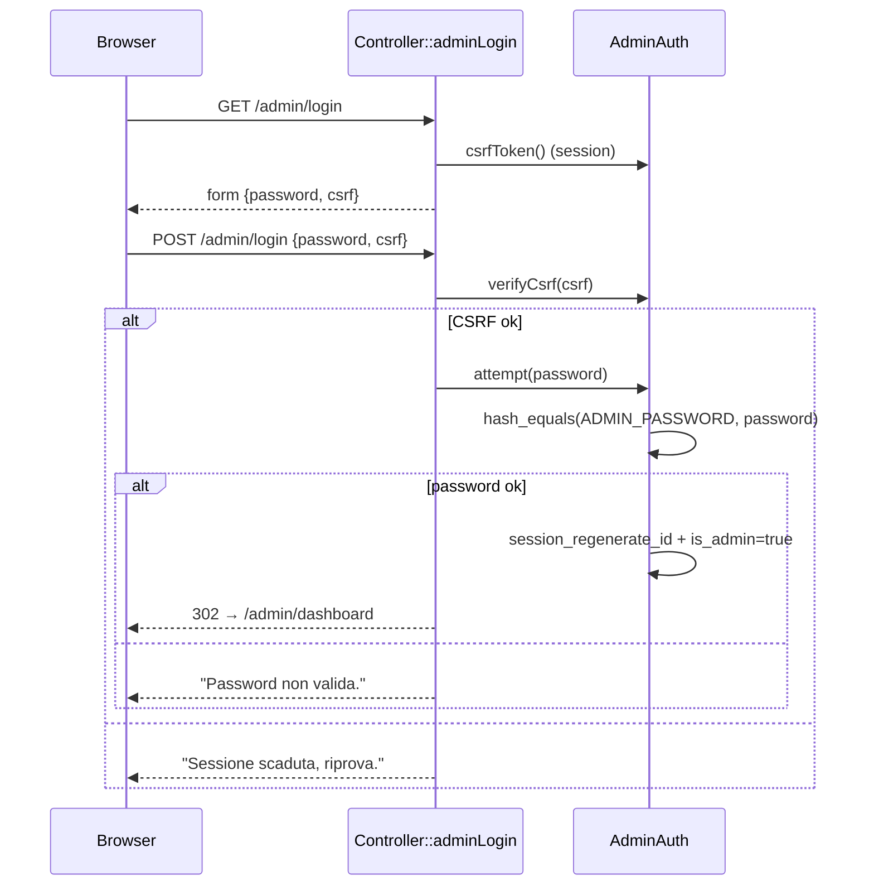
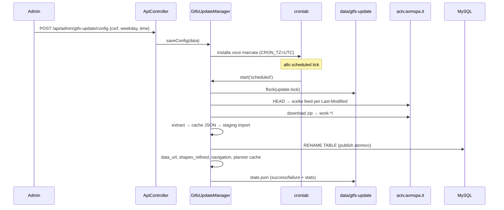
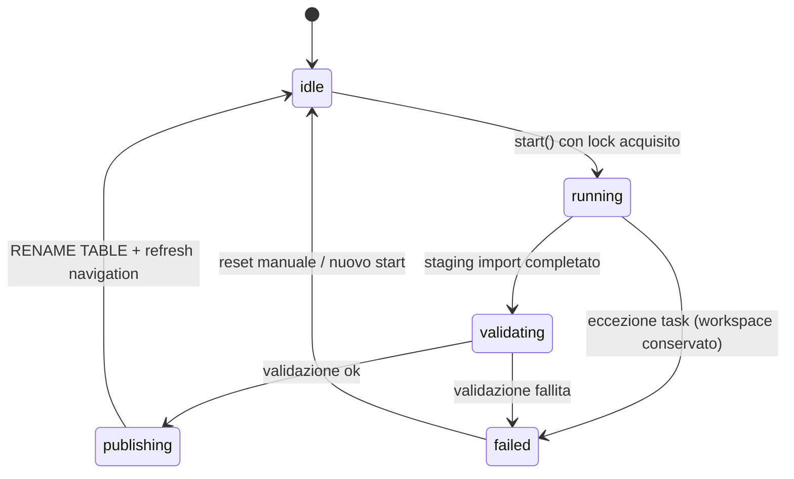
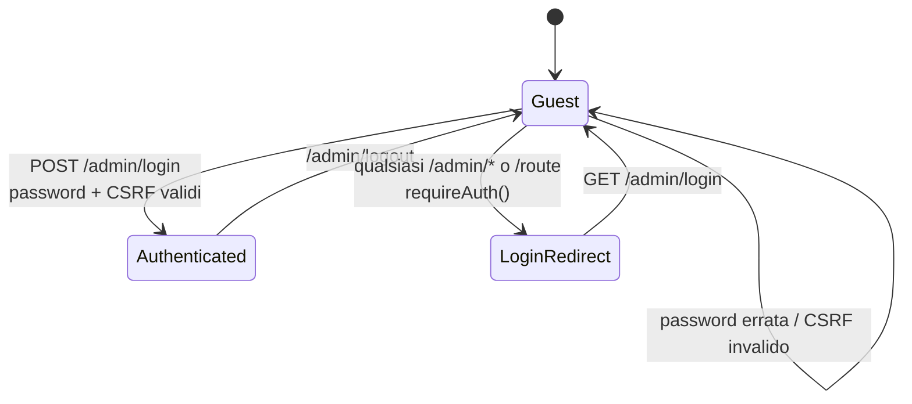
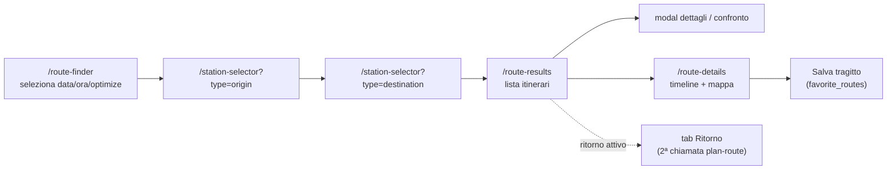

# 09 — Diagrammi UML

Tutti i diagrammi sono in sintassi Mermaid (renderizzabili su GitHub, VS Code
con estensione Mermaid, mermaid.live).

## 9.1 Diagramma delle classi (backend)

```mermaid
classDiagram
    class Router {
        -array routes
        +add(url, controller, action, params)
        +dispatch(url)
        +list() array
    }

    class Controller {
        +index()
        +stops()
        +stop()
        +routeFinder()
        +stationSelector()
        +routeResults()
        +routeDetails()
        +linesMap()
        +liveMap()
        +tripDetails()
        +widget()
        +delayStats()
        +routes()
        +lineSchedule()
        +tripFinder()
        +deleteCookie()
        +feedback()
        +credits()
        +homeAlt()
        +adminLogin()
        +adminLogout()
        +logs()
        +adminDashboard()
        +adminDatabaseHealth()
        +adminGtfsUpdate()
        +adminGtfsRealtimeInspector()
        +adminFeedback()
        -fetchData(url, timeout) array
    }

    class ApiController {
        -getDb(joins) databaseConnector
        -requireAdminJson() bool
        -adminJsonInput() ?array
        -parseLatLon(value) ?array
        -mergeNavigationStops(stops) array
        -filterStopsByParam(stops) array
        -navigationPlanner() RoutePlanner
        -enrichRealtimeVehicleTrips(vehicles, service) array
        +planRoute()
        +stops()
        +stopLines()
        +stopUpcoming()
        +navigationStops()
        +navigationLines()
        +navigationPassages()
        +navigationVehicles()
        +realtimeVehicles()
        +lineColors()
        +linesShapes()
        +tripStops()
        +busPosition()
        +lineCatalog()
        +lineVariants()
        +lineSchedule()
        +lineTrips()
        +gtfsBusesRunningNow()
        +gtfsStops()
        +gtfsPassages()
        +gtfsResolve()
        +gtfsTripBuilder()
        +gtfsStopTranslater()
        +api_gtfsIdentify()
        +logJsError()
        +feedback()
        +deleteCookie()
        +adminGtfsUpdateStatus()
        +adminGtfsUpdateConfig()
        +adminGtfsUpdateStart()
        +adminDatabaseHealth()
        +adminGtfsRealtimeInspect()
    }

    class databaseConnector {
        -PDO db
        -string tableJoins
        -static databaseConnector instance$
        +getInstance()$ databaseConnector
        +connect(user, pass, host, name, joins) bool
        +query(query, params) array
        +close()
        +getJoins() string
    }

    class AdminAuth {
        -ensureSession()$
        +check()$ bool
        +attempt(password)$ bool
        +requireAuth()$
        +logout()$
        +csrfToken()$ string
        +verifyCsrf(token)$ bool
    }

    class Logger {
        +log(type, message, file, line, stackTrace, context)$
        +phpErrorHandler(errno, errstr, errfile, errline)$
        +exceptionHandler(exception)$
    }

    class RoutePlanner {
        -string cacheDir
        -array stops
        -array routes
        -array stopRoutesIndex
        +__construct(profile)
        +findRoutes(origin, dest, time) array
        +findNearestStop(lat, lon) ?array
        +getLinesForStop(stopId, time) array
        +debugStop(id) array
        +getCacheStats() array
        -calculateGeoDistance(lat1, lon1, lat2, lon2) float
    }

    class ConnectionScanPlanner {
        +plan(origin, dest, date, time) ?array
        +planAlternatives(origin, dest, date, time) array
    }

    class ConnectionCacheBuilder {
        -string plannerDir
        -array profiles
        +pathForDate(date) string
        +ensure(date) string
        -build(date, path)
        -activeServices(dataDir, date) array
        -isFresh(path) bool
    }

    class GTFSParser {
        -string gtfsUrl
        -string dataDir
        -string cacheDir
        +downloadGTFS()
        +parseAll()
        +parseStops() array
        +parseRoutes() array
        +parseTrips() array
        +parseStopTimes()
        +isCacheValid(maxAge) bool
    }

    class GtfsUpdateManager {
        +getOverview() array
        +saveConfig(data) array
        +start(trigger) array
        -runJob(workspace)
        -syncCron(config)
    }

    class GtfsRealtime {
        +read(kind, service)$ array
        +decode(kind, raw, service)$ array
        +inspect(kind, service)$ array
        +freshVehicles(vehicles, now)$ array
        -download(url)$ string
        -vehicles(raw, service)$ array
        -updates(raw, service)$ array
    }

    class LineScheduleProvider {
        +variants(line, day, date) array
        +schedule(line, tripIds, day, date) array
    }

    class ResponseCache {
        +remember(key, ttl, producer)$ mixed
    }

    class DatabaseHealthService {
        +inspect() array
    }

    class RoadSnapper
    class gtfsReader
    class gtfsStops
    class gtfsPassages
    class gtfsBusesNowRunning
    class gtfsTripResolver

    Router ..> Controller : instanzia
    Router ..> ApiController : instanzia
    Controller ..> AdminAuth : gate /admin
    Controller ..> databaseConnector : logs, feedback
    Controller ..> Logger : errori cURL
    ApiController ..> databaseConnector : query GTFS
    ApiController ..> AdminAuth : /api/admin
    ApiController ..> RoutePlanner : nearest stop, compat
    ApiController ..> ConnectionScanPlanner : plan-route
    ApiController ..> GtfsRealtime : realtime/inspector
    ApiController ..> GtfsUpdateManager : status/config/start
    ApiController ..> DatabaseHealthService : health
    ApiController ..> LineScheduleProvider : line-schedule
    ApiController ..> ResponseCache : cache risposte
    ApiController ..> Logger : errori
    ConnectionScanPlanner ..> ConnectionCacheBuilder : ensure(date)
    GtfsUpdateManager ..> GTFSParser : rigenera cache
    RoutePlanner ..> GTFSParser : legge cache prodotta da
    ApiController ..> gtfsPassages : include model
    ApiController ..> gtfsBusesNowRunning : include model
    ApiController ..> gtfsTripResolver : include model
    Logger ..> databaseConnector : scrittura logs
```

## 9.2 Diagramma dei componenti / deployment

## 9.3 Diagrammi di sequenza

### a) Caricamento di una pagina pubblica

### b) Pianificazione percorso (`/api/plan-route`)

### c) Mappa realtime (`/live-map`)

### d) Login admin

### e) Aggiornamento GTFS schedulato

## 9.4 Diagramma di stato — aggiornamento GTFS

## 9.5 Diagramma di stato — autenticazione admin

## 9.6 Flusso utente — route finder

